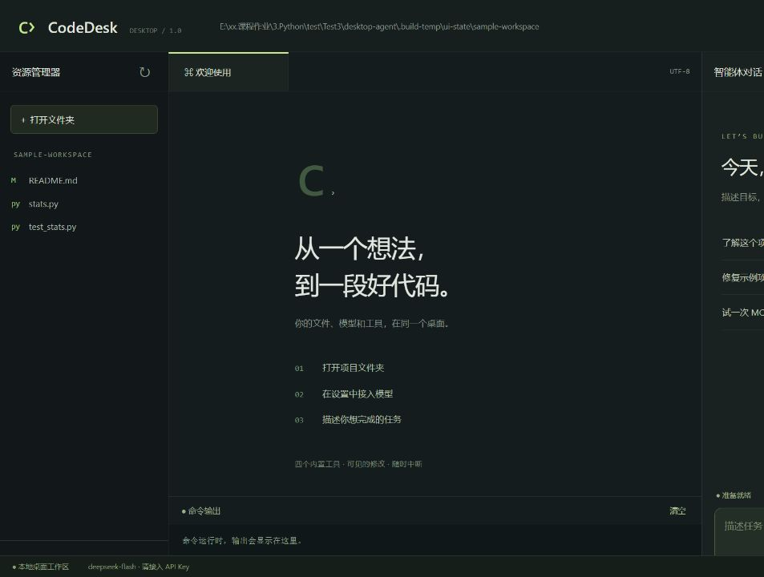

# CodeDesk 桌面智能体

Python 原生桌面代码助手与问答智能体。默认浅色，可切换深色；API Key 在桌面设置中输入。支持 DeepSeek 及 OpenAI 兼容接口，模型回复由用户配置的服务生成。

公开仓库：https://github.com/yangzaipucci/codedesk-desktop-agent

开发记录：[三天开发日志](docs/development-log.md)（2026-10-27、10-29、11-03） · [修改摘要](CHANGELOG.md) · [逐条提交索引](docs/development/commit-index.md)。10 月 27 日为需求与本地过程记录，另外两天有 Git 提交。

操作教程：[三个补丁与飞书 MCP 视频、字幕和配置](docs/tutorial/README.md)（约 7 分 07 秒，中文配音及字幕；实际操作关键画面，非连续录屏）。飞书真实账号授权需使用者自行完成。

## 三步使用

1. 从 [Release](https://github.com/yangzaipucci/codedesk-desktop-agent/releases) 下载对应版本安装包并安装；也可完整解压便携 ZIP，双击 `Start-CodeDesk.cmd`。本次源码补丁版本为 **1.2.0**。
2. 在右上角“模型与连接”选择服务、模型，输入自己的 API Key，测试后保存。可选保存到 Windows 凭据管理器。
3. 打开项目文件夹，选择助手模式并发送需求。中间编辑代码，右侧查看结果，底部显示实际命令输出。

运行环境为 Windows x64 与 Microsoft Edge WebView2 Runtime。分发包自带 Python，不要求老师另装 Python。未配置 Key 时仍可手动编辑、搜索文件和运行终端；模型对话需有效 Key 与网络。



## 可以完成什么

- 多标签代码编辑、语法高亮、查找、折叠、撤销、保存全部、新建文件/目录、项目全文搜索与快速打开。
- 关联文件与选中代码（Ctrl L）；Agent 读、写、精确编辑、运行测试；修改差异与用户撤销。保存冲突时拒绝覆盖。
- Agent 执行任务；Plan 只读制定计划，可一键转 Agent；Debug 复现、修复和复测；Ask 只读问答；Multitask 使用独立上下文依次执行多个任务。
- 实际系统时间、实时天气、通用网页检索、公开网页阅读、Crossref/arXiv 文献检索、可校验的数学计算。来源由 MCP 工具返回，重要事实需核对原网页。读取文本型 PDF、DOCX 及图片。
- 代码片段、命令和详细工具数据集中在中间区域；右侧保留结果与简短进度。文件栏、对话栏、终端高度均可拖动，双击分界线恢复。
- 浅深主题、桌面模型配置、模型列表、连接测试、MCP 服务配置、任务中断与运行记录导出。同一工作区最近会话可重启恢复。

四个内置模型工具严格为 **read / write / edit / bash**。联网、计算、时间工具通过独立 MCP 进程接入并标注来源。工具参数、真实输出、diff 与失败记录都可以查看。

## 1.2.0：给基础智能体补齐三个补丁

保留 read / write / edit / bash 四个内置工具和现有桌面界面。新增能力接入真实运行流程，而非只增加说明文件。右上角“模型与连接 → 技能、定制与常驻任务”可分别关闭。

### A. 技能系统：目录先注入，正文按需读

- 提供三个实际技能：`code-review`（纯流程提示）、`python-tests`（附可运行测试脚本）、`web-research`（调用现有 MCP）。
- 搜索顺序为随包 `agent_assets/skills/`、用户数据目录 `skills/`、项目 `.codedesk/skills/`，同名项目技能优先。每项使用 `name`、`description`、`triggers` 的 YAML 头部与 SKILL.md 正文。
- 主上下文先注入名称、短描述和 `skill://名称/SKILL.md` 地址；正文不会全部塞入。任务匹配触发词或 `/skill 名称` 时，提示模型通过原来的 **read** 加载正文。Ask/Plan 仍无写入和执行权限。
- 带脚本技能的 read 结果包含实际 `package_file` 路径，Agent/Debug 可通过 bash 执行；脚本不会因技能发现而自动运行。
- `skill_report.json` 实测目录与正文大小、披露比例、六条正反触发用例、误触发数及按需加载。度量采用 **UTF-8 字节 token 上界**，不是厂商账单，也不伪称使用了 DeepSeek 的精确 tokenizer。

### B. 定制层：规则、硬拦截、自动测试、只读审查

- 根目录提供 **30 行 AGENTS.md**，写明构建/测试命令、目录职责和安全边界。运行时自动加载全局与当前项目两层规则；全局优先读取 `%LOCALAPPDATA%\CodeDesk\AGENTS.md`，不存在时使用随包全局模板。
- 全局、项目规则注入合计最多 350 字节，完整文件较长时会裁剪并在报告标记 `truncated`。只读审查回传摘要使用剩余额度，**定制层给主上下文增加的总量不超过 500 个 UTF-8 字节 token 上界**；技能目录由 A 单独度量。
- 三条实际 hook：`pre_tool` 在动作前拦截强制递归删除、凭据文件写入和部分隐藏执行命令，并返回替代方案；`post_edit` 在 Python 修改后先检查语法，再运行同目录相关 `test_<模块>.py`；`stop` 将本次修改交给独立 reviewer。
- reviewer 使用独立模型上下文，只提供 read，并再次检查调用白名单；即使模型返回 write/bash，也不会执行。子上下文不复制整个主会话，审查结果单独落盘，摘要才回到主会话。审查受步数、时间和 token 预算约束。
- reviewer 额外拒绝读取 `.env` 和私钥/证书文件，避免把凭据带入审查上下文。
- 自动测试没有匹配用例会明确“跳过”，语法或测试失败会原样交给模型处理；不把文件写入成功误当作测试通过。审查超时、连接失败也不会被标成通过。
- 这是 CodeDesk 自己的 hook，不是修改使用者电脑上的 Codex/Cursor 全局 hooks。策略检查不是操作系统隔离，不能保证识别任意混淆脚本；bash 的权限边界见下文。

### C. 常驻任务：逐步落盘、断点恢复、完成通知

- 提供 `daemon create/run/watch/list`，支持崩溃续跑、定时轮询和完成通知，进程无须依赖桌面窗口一直打开。仅在用户明确运行命令或调用对应本机 API 时启动，不自动安装开机服务。
- 每步执行前后原子落盘，使用内核锁防止同一任务被两个进程同时执行。强制结束进程后，已完成步骤不会从头再跑；内核锁随进程退出释放。
- Windows 短暂文件共享锁会限次重试读取与替换检查点；持续无权限仍报错，不跳过保存。验收分阶段保存报告，后续失败时保留已完成项目和具体测试错误。
- `write` 通过内容 SHA256 判断完成与重入；若写入已完成但检查点尚未更新，重启会识别已有结果。若中断后被人工改动，则报告冲突并拒绝覆盖。
- `read` 为可重复的只读步骤；`agent` 可调用真实智能体，但必须提供目标文件 `expected_sha256` 完成条件。任意外部命令、服务副作用不保证 exactly-once，不能把文件步骤的幂等保证推广到一切动作。
- 完成通知按任务 ID 去重，保存在用户数据目录 `daemon/notifications/`，运行中的桌面会显示提示；CLI `daemon list` 也能查看。定时轮询只处理待执行/中断任务，不无限重试失败任务。

示例（项目根目录执行，示例会在该项目新增 `daemon-output/`）：

```powershell
.venv\Scripts\python.exe app.py daemon create --plan examples\daemon-plan.json
# 将上一步输出的 id 代入：
.venv\Scripts\python.exe app.py daemon run 任务ID
# 或保持前台轮询，Ctrl+C 停止；再次启动可继续：
.venv\Scripts\python.exe app.py daemon watch --interval 5
.venv\Scripts\python.exe app.py daemon list
```

### 能力开关与回退

桌面开关会保存到本机设置；同名环境变量优先：`ENABLE_SKILLS`、`ENABLE_CUSTOM`、`ENABLE_HOOKS`、`ENABLE_AUTOTEST`、`ENABLE_REVIEWER`、`ENABLE_DAEMON`。值为 `0`/`false`/`off` 时关闭。关闭 CUSTOM 同时关闭其 hooks、自动测试和 reviewer。

`$env:ENABLE_SKILLS='0'` 仅关闭技能发现与加载；`$env:CODEDESK_LEGACY='1'` 一次关闭全部三个补丁，回到本项目补丁前的四工具运行流程。既有多模型、浅深主题、编辑器和 MCP 客户端保持。关闭后重新打开应用；恢复时删除环境变量或改成 `1`（LEGACY 改 `0`）。

### 自动验收：数字由 app.inspect 产生

```powershell
.venv\Scripts\python.exe app.py inspect --output reports
```

命令打印 JSON（中文以标准 Unicode 转义输出，兼容英文 Windows 控制台；解析后文字不变），返回非零状态表示有项未通过，并生成：

安装/便携版不需要开发环境：在 CodeDesk 运行目录执行 `runtime\python.exe app\app.py inspect --output reports`。其他 CLI 命令也可用这组解释器与入口替换 `.venv\Scripts\python.exe app.py`。

- [skill_report.json](reports/skill_report.json)：目录大小、全文大小、披露比例、6 条触发用例和误触发。
- [custom_report.json](reports/custom_report.json)：两层 AGENTS.md、真实拦截与替代方案、实际自动测试、只读 reviewer 和主上下文增量。
- [daemon_report.json](reports/daemon_report.json)：实际启动独立进程，前三步完成后**强制终止**，重启从第 4 步继续，核对未重复写入及通知数量。
- [mcp_report.json](reports/mcp_report.json)：实际启动 HTTP MCP 服务，核对未认证 401、非法来源 403、SDK 工具发现和真实调用。

为避免占用已有服务，HTTP 验收选一个临时空闲端口；`tested_port` 是实际测试值，`default_port` 仍是产品默认的 8001。

默认验收的模型审查部分使用明确标注的受控 Provider，文件工具、测试命令、进程终止恢复及 HTTP MCP 都实际执行；这些结果不冒充真实模型质量评测。生产 reviewer 使用桌面配置的模型 API。报告 token 是公开说明的保守计量，不是手写分数。请开启相关补丁后验收；关闭功能时不能伪报它通过。

[新增开关与端口界面](docs/screenshots/05-patches-120.png) · [12 秒实际交互关键画面演示](docs/patches-demo.mp4)（非连续录屏）。

## MCP 协议、端口与连接配置

MCP 支持 stdio 和 Streamable HTTP。**stdio 通过子进程标准输入输出通信，不占 TCP 端口；HTTP 端口由服务选择，并非 MCP 协议统一规定。** 参见 [官方传输规范](https://modelcontextprotocol.io/specification/2025-11-25/basic/transports)。

本项目新增的 HTTP MCP 服务默认地址是 **`http://127.0.0.1:8001/mcp`**，通过 `--port` 修改，仅监听本机。它与桌面后端 `--headless --port 8765` 是两个独立服务；桌面窗口默认使用自动分配端口，不能把它当作 MCP 端口。

HTTP 服务要求独立的 `CODEDESK_MCP_TOKEN`（至少 16 字符），它是本机 MCP 连接令牌，**不是 DeepSeek API Key**。不会自动读取或转发模型 Key。

在项目根目录同一 PowerShell 中启动服务与桌面，二者继承相同令牌：

```powershell
$env:CODEDESK_MCP_TOKEN = (& .venv\Scripts\python.exe -c "import secrets; print(secrets.token_urlsafe(24))")
Start-Process -FilePath "$PWD\.venv\Scripts\python.exe" -ArgumentList @('app.py','mcp','--workspace','.','--port','8001') -WorkingDirectory "$PWD" -WindowStyle Hidden
.venv\Scripts\python.exe app.py
```

然后在桌面设置的 MCP JSON 框填入以下对象，保存后点击检查。若已有配置，合并服务项，不覆盖原服务：

```json
{
  "codedesk-local-http": {
    "transport": "streamable-http",
    "url": "http://127.0.0.1:8001/mcp",
    "token_env": "CODEDESK_MCP_TOKEN",
    "enabled": true
  }
}
```

服务提供真实 `workspace_info` 只读工具，返回所选目录的名称、文件名及当前时间；需要先启动才能连接。端口被占用时更换 `--port`，并同步修改配置 URL。HTTP 服务校验 Bearer 令牌和 Origin；未认证返回 401，非法来源返回 403。

也可使用 stdio：服务命令为 Python 解释器，参数为 `app.py mcp --transport stdio --workspace 项目目录`，不需 `8001` 或 HTTP 令牌。原来的 `workspace-demo` 和 `codedesk-online` 仍采用 stdio，不依赖本机 HTTP 服务。

## 源码启动（3 步）

1. Windows 安装 Python 3.12 和 Node.js 24，克隆仓库后执行 `python -m venv .venv`。
2. 执行 `.venv\Scripts\python -m pip install -r requirements-lock.txt`，再执行 `npm ci` 与 `npm run build`。
3. 执行 `.venv\Scripts\python app.py`，在桌面中填写 Key。

前端源码在 `frontend/`，离线构建产物在 `ui/`；前端不依赖外部 CDN。完整 Python 和 npm 版本锁定文件均入仓库。

## 验证与构建

`python -m unittest discover -s tests -v`、`npm test`、`npm run build`。GitHub Actions 在 Windows 执行回归、构建分发包并在独立运行器验证安装/启动/MCP/卸载。

便携与预览安装包：`python scripts/build_portable.py --installer --iscc "Inno Setup目录\ISCC.exe"`。官方 Python 运行环境校验原始下载哈希，分发包保留文件清单与源码提交。完整签名构建、时间戳及发布门禁见 [签名流程](docs/signing.md)，当前预览安装包文件名明确带 `unsigned`。

独立后端：`python app.py --headless --port 8765`。后端仅监听 127.0.0.1；使用控制台本机会话 token 认证（不是模型 Key）。`POST /api/run` 的 JSON 为 `{"prompt":"任务","mode":"agent"}`，curl.exe 加 `-N` 查看 SSE；`POST /api/stop` 中断，`GET /api/trace` 导出记录。

## 数据和边界

Key 默认仅留在内存；选择系统保存后由 Windows 凭据管理器保存，配置 JSON、源码、浏览器持久存储和安装包均不保存真实 Key。设置/会话/撤销快照位于 `%LOCALAPPDATA%\CodeDesk`，对外分享记录前检查项目内容。

文件工具限制所选目录；bash 使用当前用户权限，工作目录不是操作系统沙箱。命令对 Git、网络、依赖和文件的副作用需要人工审阅。撤销只覆盖登记的文件修改。关闭“联网查询”是模型行为约束，不是操作系统断网机制。

本项目提供课程级桌面工作台，尚不包含 Cursor 的扩展市场、完整语言服务器、Tab 预测补全、远程协作与并行工作树。Multitask 为串行队列。扫描 PDF 需 OCR，联网源可能限流或不可达，文献元数据不等于已读全文或已核实同行评审。其他服务商有预设，但本次真实 Key 实测使用 DeepSeek。

材料：[设计报告](report.md)、[构建说明](docs/build.md)、[验证记录](docs/validation.md)、[现场演示与抽查](docs/demo-guide.md)、[运行记录](docs/trace.md)、[视频](demo.mp4)。
