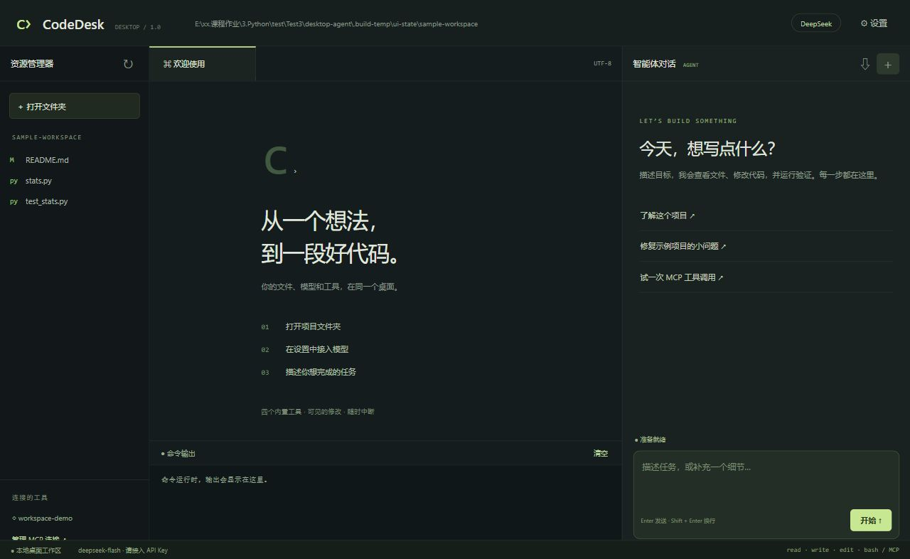
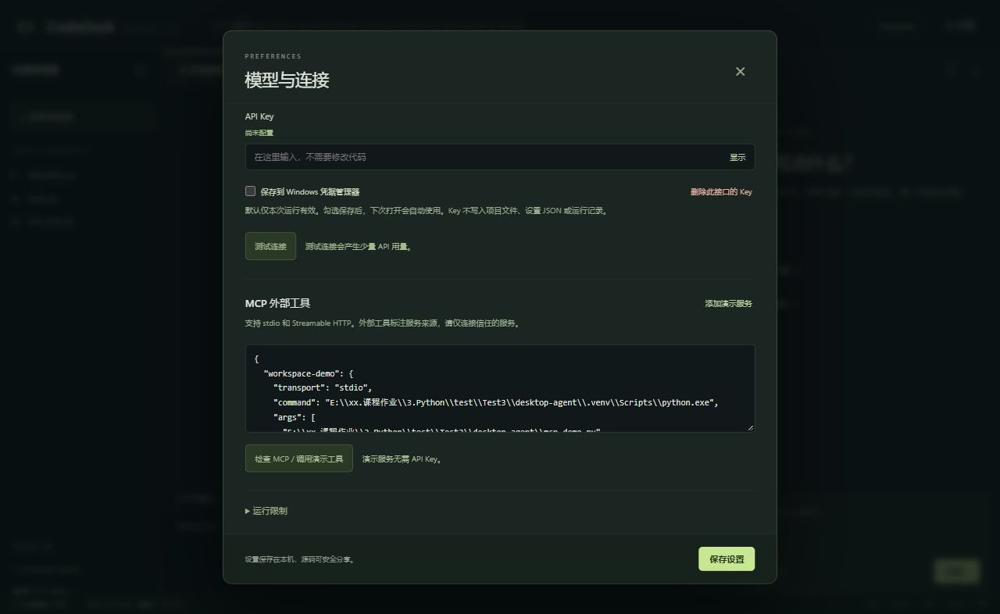
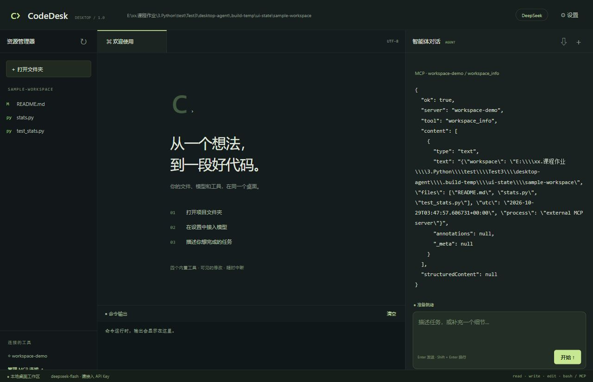

# CodeDesk 桌面智能体

可以双击安装、在桌面接入自己的大模型、读文件、改代码和执行测试的 Python 智能体。原生窗口中提供文件树、代码预览、对话、工具过程、diff、命令输出及中断。

## 三步使用

1. 下载 Release 中的 CodeDesk-Setup-1.0.0.exe，安装后双击 CodeDesk 图标。
2. 点击设置，选择服务商，在窗口中填写 Base URL、模型名称和 API Key，测试连接后保存。不修改源码，不把 Key 发到聊天。
3. 打开项目文件夹，在右侧输入任务。首次启动自带一个有意保留错误的示例项目。

Key 默认仅本次运行有效；勾选保存后写入 Windows 凭据管理器。不同接口地址分开保存，不进入源码、设置 JSON、浏览器持久存储或安装包。

Release同时提供CodeDesk-Portable-1.0.0-win64.zip。解压完整目录后双击CodeDesk.exe即可运行，此版本已通过独立启动、资源和随包MCP验证。本次设备应用程序控制策略拦截未签名Setup安装器，安装验收尚未完成；不建议关闭系统保护，受同类策略管理的电脑请先向设备管理员确认允许的安装方式。

## 界面

## 功能

- read：逐行分页、行号、剩余行数，图片返回多模态内容块。
- write：自动建目录、临时文件加原子替换、原新行数及diff。
- edit：精确唯一替换，找不到或不唯一时拒绝修改。
- bash：Windows 使用 PowerShell，返回 stdout、stderr、exit_code，提供超时、输出截断和中断。
- 修改差异查看及用户发起的撤销。撤销校验文件是否又被修改，冲突时拒绝覆盖；它不是第五个模型工具。
- DeepSeek、OpenAI、通义千问、Kimi、GLM、自定义兼容接口。服务地址和模型可编辑，可获取模型列表。
- 步数、token估算预算、总超时、重复调用限制。长会话按完整旧轮次裁剪，保持工具消息配对。
- stdio / Streamable HTTP MCP，外部工具来源标注，随安装包附带独立MCP演示进程。
- 独立后端、WebSocket、SSE，以及可导出的工具运行记录。

## 源码三步启动

要求 Windows x64、Python 3.12、Microsoft Edge WebView2 Runtime。

1. 克隆仓库进入目录，执行 `python -m venv .venv`。
2. 执行 `.venv\Scripts\python -m pip install ".[build,test]"`。
3. 执行 `.venv\Scripts\python app.py`，在桌面设置内填 Key。

网络慢时安装命令可附加 `--index-url https://pypi.tuna.tsinghua.edu.cn/simple`。完整版本锁定见 requirements-lock.txt。安装包自带应用 Python；运行用户项目需要的 Python、Git、Node 等开发工具需另行具备。

## 无需Key验证MCP

设置中点击添加演示服务，再点击检查MCP / 调用演示工具。独立进程返回实际目录、文件名与时间。其他服务可参照 mcp.json，将 mcpServers 内的对象填入设置框。只连接信任的服务。当前每次发现和调用分别建立连接，适合无状态工具，跨调用内存状态和OAuth场景未完整支持。

## 独立后端与验证

运行 `.venv\Scripts\python app.py --headless --port 8765`。终端输出的本机会话token不是模型Key。请求 `/api/run` 时使用 `Authorization: Bearer 本机会话token`，JSON为 `{"prompt":"任务内容"}`，curl.exe 加 `-N` 可见SSE。模型Key可提前在桌面设置中选择系统保存。`POST /api/stop`中断，`GET /api/trace`导出记录。

自动检查：`.venv\Scripts\python -m unittest discover -s tests -v`，以及 `node --check ui/app.js`。GitHub Actions在Windows运行同类检查。

打包：`.venv\Scripts\python scripts\build_windows.py --iscc "Inno Setup目录\ISCC.exe"`。输出 release/CodeDesk-Setup-1.0.0.exe。

## 仓库内容

agent/：独立循环、工具、凭据、撤销和MCP。server/：本地API。ui/：完整前端。tests/：回归检查。sample_workspace/：首次体验项目。scripts/：打包及GitHub发布。docs/：截图、实际工具记录、验证、演示、发布说明。report.md：设计报告。

文档：[构建](docs/build.md)、[验证](docs/validation.md)、[运行记录](docs/trace.md)、[演示](docs/demo-guide.md)、[发布](docs/release-notes.md)、[设计报告](report.md)。

[实际界面与MCP演示视频](demo.mp4) 展示文件预览、Key配置入口及真实MCP调用，不含真实模型Key或模型任务验收。

## 使用边界

文件工具限制工作目录；bash按当前用户权限运行，工作目录不是操作系统沙箱。请查看diff与测试结果。撤销只适用于write/edit登记的修改，不能撤销任意命令的全部副作用。

设置、记录和撤销快照位于 %LOCALAPPDATA%\CodeDesk。快照及运行记录可能含项目内容，对外分享前检查。当前不支持重启后恢复完整模型对话，token预算是估算，不是精确账单。

厂商预设不代表逐家使用真实Key验收，模型需支持Chat Completions及function tools。真实联网验收需要用户在桌面输入有效Key。提交时间跨度按本次用户要求不作为交付条件。公开仓库只包含完整源码与材料，安装包放在Release附件，缓存和真实Key不进Git。
