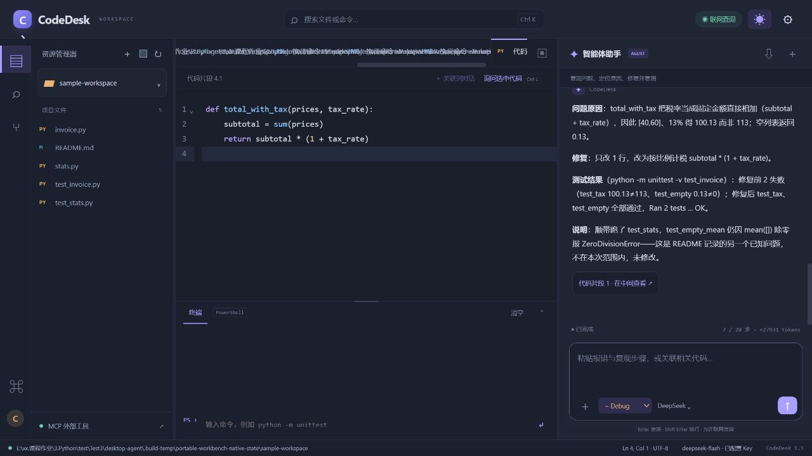
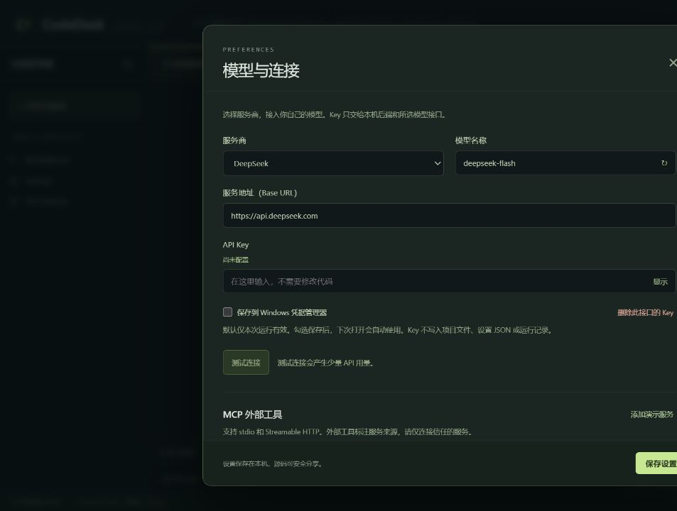

# CodeDesk 桌面智能体

Python 原生桌面代码助手与问答智能体。默认浅色，可切换深色；API Key 在桌面设置中输入。支持 DeepSeek 及 OpenAI 兼容接口，模型回复由用户配置的服务生成。

公开仓库：https://github.com/yangzaipucci/codedesk-desktop-agent

开发记录：[三天开发日志](docs/development-log.md)（2026-10-27、10-29、11-03） · [修改摘要](CHANGELOG.md) · [逐条提交索引](docs/development/commit-index.md)。10 月 27 日为需求与本地过程记录，另外两天有 Git 提交。

操作演示：[编号2：增量作业真实操作视频、字幕与章节](docs/tutorial/README.md)。视频明确区分受控模型验证与真实 API 使用；飞书账号授权仍需使用者自行完成。

## 三步使用

1. 从 [Release](https://github.com/yangzaipucci/codedesk-desktop-agent/releases) 下载对应版本安装包并安装；也可完整解压便携 ZIP，双击 `Start-CodeDesk.cmd`。本次源码与安装包版本为 **1.3.1**。
2. 在右上角“模型与连接”选择服务、模型，输入自己的 API Key，测试后保存。可选保存到 Windows 凭据管理器。
3. 打开项目文件夹，选择助手模式并发送需求。中间编辑代码，右侧查看结果，底部显示实际命令输出。

运行环境为 Windows x64 与 Microsoft Edge WebView2 Runtime。分发包自带 Python，不要求老师另装 Python。未配置 Key 时仍可手动编辑、搜索文件和运行终端；模型对话需有效 Key 与网络。






## 可以完成什么

- 多标签代码编辑、语法高亮、查找、折叠、撤销、保存全部、新建文件/目录、项目全文搜索与快速打开。
- 关联文件与选中代码（Ctrl L）；Agent 读、写、精确编辑、运行测试；修改差异与用户撤销。保存冲突时拒绝覆盖。
- Agent 执行任务；Plan 只读制定计划，可一键转 Agent；Debug 复现、修复和复测；Ask 只读问答；Multitask 使用独立上下文依次执行多个任务。
- 实际系统时间、实时天气、通用网页检索、公开网页阅读、Crossref/arXiv 文献检索、可校验的数学计算。来源由 MCP 工具返回，重要事实需核对原网页。读取文本型 PDF、DOCX 及图片。
- 代码片段、命令和详细工具数据集中在中间区域；右侧保留结果与简短进度。文件栏、对话栏、终端高度均可拖动，双击分界线恢复。
- 浅深主题、桌面模型配置、模型列表、连接测试、MCP 服务配置、任务中断与运行记录导出。同一工作区最近会话可重启恢复。

四个内置模型工具严格为 **read / write / edit / bash**。联网、计算、时间工具通过独立 MCP 进程接入并标注来源。工具参数、真实输出、diff 与失败记录都可以查看。

## 1.3.1：按增量作业完成 A、B 与选做 C

本次以 `增量作业_给Cursor装技能.md` 的行为和验收字段为准，四个内置工具继续是 read / write / edit / bash。

### A：可移植技能与渐进披露

根目录 `skills/` 包含六个可带走的技能，每项不超过80行：

- `run-tests`：纯流程提示，跑测试并报告失败。
- `review-diff`：带 `scripts/collect_diff.py`，实际收集 Git 差异和统计。
- `fetch-issue`：通过已连接 MCP 的 `fetch_webpage` 读取公开 Issue。
- 保留原有 `code-review`、带脚本的 `python-tests`、走 MCP 的 `web-research`。

发现顺序为随包技能、源码根技能、用户数据目录 `skills/`、项目 `.codedesk/skills/`、项目根 `skills/`；后者覆盖同名项。目录按名称稳定排序，模型先看到 name/description；`description` 明确包含 Use this when 场景和触发语。正文与脚本通过 `read(skill://名称/文件)` 按需读取；内部提供 `Skills.use_skill(name)`，没有增加第五个内置工具。

token 使用随包离线 cl100k_base BPE 分词表计算，**不是 UTF-8 字节数，也不是 DeepSeek 账单 token**。报告含九条正反试验、三种形态、零误触发检查、实际脚本与 MCP 调用，以及同代码同任务开关对比。受控试验用于重复验证机制，不代表真实模型普遍提速。

### B：规则、三个 hook 与独立审查

- 从工作目录逐级向上找最近的项目 `AGENTS.md`。全局依次使用应用数据目录、用户主目录或随包模板；按全局→项目注入，合计上限12000字节，单份最多300行。源码根规则提供地图、构建测试、代码风格与项目坑。
- 动作前代码拦截 `.env`/私钥写入、递归强删、`git push --force`/`-f`/强制引用、`git reset --hard`，拒绝包含原因与替代方案。危险命令验收直接检查 pre-tool 策略，绝不进入真实命令执行。
- 每次 write/edit 后检查相关测试；Python 先检查语法，再跑相邻 `test_<文件>.py` 或项目 tests。只把“用例/期望/实际”三行回注模型，不塞完整 traceback。缺少用例会明确跳过，不当成通过。测试使用独立缓存位置，避免同一秒、相同长度的修复被旧 pyc 遮盖。
- reviewer 独立上下文，只有 read 和受限 git diff。命令以参数列表执行，拒绝管道、分号、外部 diff、输出文件和越界路径。固定检查改动范围、依赖、吞异常、新分支测试、print/TODO 五项；只回最终消息，主上下文增量至多500个BPE token。
- `custom_report.json` 必须记录至少一次真实 Runtime 的红转绿；当前验收重复两次。受控 Provider 提出修改、读取真实测试反馈后修复；文件编辑、测试进程和 Git 差异都实际执行，不冒充真实模型质量评测。

### C：到点技能、崩溃恢复、系统完成通知

已实现三项，超过四选二最低要求：

1. `routines.yaml` 支持带时区的单次 `at` 或 `every_seconds` 周期，20条以内。时间未到不执行，到点运行指定技能；持久化认领和队列锁阻止同一时间槽重复触发。
2. 后台任务每一步原子落盘，内核锁保护执行。硬中断后从未完成的第4步继续，核对内容 SHA256 和修改时间，前面步骤不重写；外部修改会报告冲突并停止。
3. 完成后请求 Windows 系统托盘通知，并在应用内保留去重提示。报告 `notify_fired` 表示实际系统接口接受请求，是否弹出受 Windows 专注模式等设置控制；失败会记录原因，不冒报成功。

定时配置默认 `enabled: false`，不会未经启用就消耗模型额度。将根目录示例复制到自己的项目、启用并设置时间；在桌面设置保存模型与功能开关后，点击“启动定时技能”。点击停止或关闭窗口会停止这个窗口的定时器。

独立常驻进程可在项目根执行：

```powershell
python -m app daemon watch --routines routines.yaml --interval 5
# 另一个窗口查看任务；Ctrl+C停止，后台步骤检查点保留
python -m app daemon list
python -m app daemon create --plan examples/daemon-plan.json
python -m app daemon run 任务ID
```

独立进程的模型 Key 可读取已由桌面保存的 Windows 凭据。只保存在桌面窗口内存的 Key 不会跨进程复制。定时任务按时间槽先认领再执行；遇到故障会保留状态，**不自动重放任意外部副作用**。文件步骤的幂等保证不等于所有网络操作恰好执行一次。未实现文件监听触发，本作业选做采用以上三项。

### 开关与基线回归

桌面设置可分别关闭，环境变量优先：`ENABLE_SKILLS`、`ENABLE_CUSTOM`、`ENABLE_HOOKS`、`ENABLE_AUTOTEST`、`ENABLE_REVIEWER`、`ENABLE_DAEMON`、`ENABLE_SCHEDULER`、`ENABLE_RESUME`、`ENABLE_NOTIFICATIONS`。值为0/false/off关闭；关闭 CUSTOM 也关闭其三个子能力，关闭 DAEMON 也关闭定时、恢复和系统通知。

`CODEDESK_LEGACY=1` 一次关闭所有增量，保留四工具、原界面和 MCP。老师现场可对同一代码设置 `ENABLE_SKILLS=0`/1 跑同一任务；不是拿两个版本截图比较。`python -m app.selftest` 会在关闭增量的条件下实际检查四工具、分页、精确替换、图片与界面资源。

### 三条指定验收命令

激活源码虚拟环境后执行，或将 `python` 换成 `.venv\Scripts\python.exe`：

```powershell
python -m app.inspect skills --out skill_report.json
python -m app.inspect custom --out custom_report.json
python -m app.inspect daemon --out daemon_report.json
```

三条均不依赖界面，向标准输出打印 JSON 并写入 `--out` 文件，失败返回非零。仓库提交的生成文件在 [reports/](reports/)。`python app.py inspect --output reports` 保留兼容入口，还会验收 HTTP MCP 认证与真实调用。分发包中在 CodeDesk 目录执行 `runtime\python.exe -m app.inspect skills --out skill_report.json`，无需安装开发 Python。

验收明确使用稳定受控模型，**真实执行工具、脚本、测试、进程中断恢复和 MCP**；真实模型仍通过桌面填写的 API 调用。报告不声称测试过未授权的飞书账号，不手写验收数字。

阶段标签为 `v1.0`（指向保留的工作台基线）、`v1.1`（技能，其他增量默认关闭）、`v1.2`（定制，常驻默认关闭）、`v1.3`（完整选做与最终材料）。它们是课程阶段标签；原有 `v1.0.0`、`v1.1.0`、`v1.2.0` 发布记录保持不动。安装包使用新版本 **v1.3.1**，不覆盖历史发布。

## MCP 协议、端口与连接配置

MCP 支持 stdio 和 Streamable HTTP。**stdio 通过子进程标准输入输出通信，不占 TCP 端口；HTTP 端口由服务选择，并非 MCP 协议统一规定。** 参见 [官方传输规范](https://modelcontextprotocol.io/specification/2025-11-25/basic/transports)。

本项目新增的 HTTP MCP 服务默认地址是 **`http://127.0.0.1:8001/mcp`**，通过 `--port` 修改，仅监听本机。它与桌面后端 `--headless --port 8765` 是两个独立服务；桌面窗口默认使用自动分配端口，不能把它当作 MCP 端口。

HTTP 服务要求独立的 `CODEDESK_MCP_TOKEN`（至少 16 字符），它是本机 MCP 连接令牌，**不是 DeepSeek API Key**。不会自动读取或转发模型 Key。

在项目根目录同一 PowerShell 中启动服务与桌面，二者继承相同令牌：

```powershell
$env:CODEDESK_MCP_TOKEN = (& .venv\Scripts\python.exe -c "import secrets; print(secrets.token_urlsafe(24))")
Start-Process -FilePath "$PWD\.venv\Scripts\python.exe" -ArgumentList @('app.py','mcp','--workspace','.','--port','8001') -WorkingDirectory "$PWD" -WindowStyle Hidden
.venv\Scripts\python.exe app.py
```

然后在桌面设置的 MCP JSON 框填入以下对象，保存后点击检查。若已有配置，合并服务项，不覆盖原服务：

```json
{
  "codedesk-local-http": {
    "transport": "streamable-http",
    "url": "http://127.0.0.1:8001/mcp",
    "token_env": "CODEDESK_MCP_TOKEN",
    "enabled": true
  }
}
```

服务提供真实 `workspace_info` 只读工具，返回所选目录的名称、文件名及当前时间；需要先启动才能连接。端口被占用时更换 `--port`，并同步修改配置 URL。HTTP 服务校验 Bearer 令牌和 Origin；未认证返回 401，非法来源返回 403。

也可使用 stdio：服务命令为 Python 解释器，参数为 `app.py mcp --transport stdio --workspace 项目目录`，不需 `8001` 或 HTTP 令牌。原来的 `workspace-demo` 和 `codedesk-online` 仍采用 stdio，不依赖本机 HTTP 服务。

## 源码启动（3 步）

1. Windows 安装 Python 3.12 和 Node.js 24，克隆仓库后执行 `python -m venv .venv`。
2. 执行 `.venv\Scripts\python -m pip install -r requirements-lock.txt`，再执行 `npm ci` 与 `npm run build`。
3. 执行 `.venv\Scripts\python app.py`，在桌面中填写 Key。

前端源码在 `frontend/`，离线构建产物在 `ui/`；前端不依赖外部 CDN。完整 Python 和 npm 版本锁定文件均入仓库。

## 验证与构建

`python -m unittest discover -s tests -v`、`npm test`、`npm run build`。GitHub Actions 在 Windows 执行回归、构建分发包并在独立运行器验证安装/启动/MCP/卸载。

便携与预览安装包：`python scripts/build_portable.py --installer --iscc "Inno Setup目录\ISCC.exe"`。官方 Python 运行环境校验原始下载哈希，分发包保留文件清单与源码提交。完整签名构建、时间戳及发布门禁见 [签名流程](docs/signing.md)，当前预览安装包文件名明确带 `unsigned`。

独立后端：`python app.py --headless --port 8765`。后端仅监听 127.0.0.1；使用控制台本机会话 token 认证（不是模型 Key）。`POST /api/run` 的 JSON 为 `{"prompt":"任务","mode":"agent"}`，curl.exe 加 `-N` 查看 SSE；`POST /api/stop` 中断，`GET /api/trace` 导出记录。

## 数据和边界

Key 默认仅留在内存；选择系统保存后由 Windows 凭据管理器保存，配置 JSON、源码、浏览器持久存储和安装包均不保存真实 Key。设置/会话/撤销快照位于 `%LOCALAPPDATA%\CodeDesk`，对外分享记录前检查项目内容。

文件工具限制所选目录；bash 使用当前用户权限，工作目录不是操作系统沙箱。命令对 Git、网络、依赖和文件的副作用需要人工审阅。撤销只覆盖登记的文件修改。关闭“联网查询”是模型行为约束，不是操作系统断网机制。

本项目提供课程级桌面工作台，尚不包含 Cursor 的扩展市场、完整语言服务器、Tab 预测补全、远程协作与并行工作树。Multitask 为串行队列。扫描 PDF 需 OCR，联网源可能限流或不可达，文献元数据不等于已读全文或已核实同行评审。其他服务商有预设，但本次真实 Key 实测使用 DeepSeek。

材料：[设计报告](report.md)、[构建说明](docs/build.md)、[验证记录](docs/validation.md)、[现场演示与抽查](docs/demo-guide.md)、[运行记录](docs/trace.md)、[视频](demo.mp4)。
